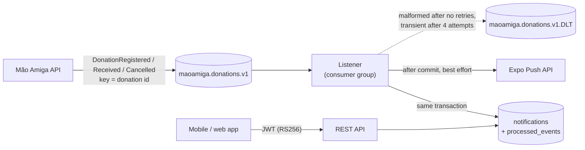

# notification-service

[](https://github.com/jonatasEdward/notification-service/actions/workflows/ci.yml)
[](LICENSE)

Event-driven service that turns domain events into user notifications. It consumes events from Kafka, stores one notification per recipient, exposes them through a small REST API, and sends push messages to the recipients' phones through Expo.

Its first producer is [Mão Amiga](https://github.com/jonatasEdward/instituto-mao-amiga), an app that connects donors to donation drop-off points. When a donation is registered, the person who runs the point is told. When the point confirms it arrived, the donor is told.

This is a reference project. The [end-to-end workflow](#end-to-end-test-tracing-and-load) runs the whole system, both services plus Kafka, PostgreSQL and the tracing stack, and publishes the results; [Running locally](#running-locally) starts it on your machine.

## How it works



1. The producer publishes an event keyed by donation id, so all events of one donation are consumed in order.
2. The listener validates the message, skips event types it does not know, and checks `processed_events` for the event id.
3. Notifications and the event id are written in one transaction. A redelivered event finds its id and is skipped.
4. After the commit, recipients' devices get a push. Failures there are logged and never block the partition.
5. Messages that can never be processed go straight to the dead-letter topic. Transient failures are retried with exponential backoff first.

## Guarantees

| Concern | What the service guarantees |
| --- | --- |
| Duplicates | Each event produces its notifications once, even though Kafka delivers at least once ([ADR 2](docs/adr/0002-idempotent-consumer.md)) |
| Ordering | Events of the same donation are processed in the order they were published |
| Poison messages | Malformed events go to `.DLT` immediately instead of blocking their partition |
| Producer outage | Events already in Kafka are still delivered; the service never calls the producer ([ADR 3](docs/adr/0003-events-carry-the-data-consumers-need.md)) |
| Push outage | Notifications are stored first; push is best effort ([ADR 4](docs/adr/0004-in-app-first-push-best-effort.md)) |
| Contract evolution | Unknown fields and unknown event types are ignored, so producers can add to the contract safely |

## Event contract

Topic `maoamiga.donations.v1`, key `donation.id`, JSON value described in [`docs/events/donation-event.v1.schema.json`](docs/events/donation-event.v1.schema.json):

```json
{
  "eventId": "7d1f0c7e-3b8e-4d6a-9a52-2f5e7b1c9a01",
  "eventType": "DonationRegistered",
  "occurredAt": "2026-11-24T13:00:00Z",
  "donation": {
    "id": "5b2c7e10-8a4f-4c3e-b1d2-6e9f0a1b2c3d",
    "item": "Feijão 1kg",
    "quantity": 6,
    "pointId": "10000000-0000-0000-0000-000000000001",
    "pointName": "Ponto Central",
    "donorId": "00000000-0000-0000-0000-000000000002",
    "responsibleId": "00000000-0000-0000-0000-000000000001"
  }
}
```

## API

All endpoints take a JWT issued by the Mão Amiga API. Tokens are signed with RS256 and verified against the issuer's JWKS endpoint, so the two services share no secret.

| Method | Path | Description |
| --- | --- | --- |
| GET | `/api/v1/notifications?page=0&size=20` | the caller's notifications, newest first |
| GET | `/api/v1/notifications/unread-count` | number of unread notifications |
| POST | `/api/v1/notifications/{id}/read` | mark one as read (404 if it belongs to someone else) |
| POST | `/api/v1/notifications/read-all` | mark all as read |
| PUT | `/api/v1/devices` | register the caller's Expo push token |
| DELETE | `/api/v1/devices` | remove a push token, e.g. on logout |

Errors use Problem Details (RFC 9457).

## Code organization

Packages are organized by feature, and `ArchitectureTest` (ArchUnit) keeps the boundaries in place:

```
io.github.jonatasedward.notifications
├── events/          Kafka listener, event contract, idempotency, retry and DLT setup
├── notifications/   storage and REST API; knows nothing about Kafka or where events come from
├── devices/         push token registration
├── push/            Expo client and best-effort delivery
└── shared/          security, errors, paging
```

Only `events` may depend on Kafka. `notifications` must not depend on `events`, so adding a second producer means adding a translator in `events` without touching storage or the API.

## Running locally

Requirements: JDK 21, Maven 3.9+ and Docker.

```bash
docker compose up -d postgres kafka
mvn spring-boot:run
```

Publish the example event and see it consumed:

```bash
docker compose exec -T kafka /opt/kafka/bin/kafka-console-producer.sh \
  --bootstrap-server localhost:9092 --topic maoamiga.donations.v1 \
  --property parse.key=true --property key.separator='|' \
  < <(printf '5b2c7e10-8a4f-4c3e-b1d2-6e9f0a1b2c3d|%s\n' "$(cat docs/events/examples/donation-registered.json)")
```

The service logs the push it would have sent (`push (not sent)`); real pushes are enabled with `PUSH_EXPO_ENABLED=true`.

## Tests

```bash
mvn verify
```

Integration tests start real Kafka and PostgreSQL containers with Testcontainers. They cover the full path from a message on the topic to the REST API, including redelivery of the same event, unknown event types, and a malformed message ending up on the dead-letter topic with the exception recorded in its headers.

## End-to-end test, tracing and load

The [`End-to-end and load test`](.github/workflows/e2e.yml) workflow builds both services and runs the whole system on a GitHub Actions runner: Mão Amiga API, this service, Kafka, two PostgreSQL instances and Grafana LGTM (OpenTelemetry collector, Tempo, Grafana). Both services run with the OpenTelemetry Java agent. The workflow then:

1. **Smoke test** ([`e2e/smoke.sh`](e2e/smoke.sh)): registers a donation in the Mão Amiga API and waits for the responsible person to be notified here, then confirms it and waits for the donor's notification. This only passes if the outbox, Kafka, the idempotent consumer and RS256 token validation through JWKS all work together.
2. **Trace check** ([`e2e/trace-check.sh`](e2e/trace-check.sh)): asks Tempo for a trace that starts in the Mão Amiga API and reaches this service, and fails if there is none.
3. **Load test** ([`e2e/load/donations.js`](e2e/load/donations.js)): k6 registers donations at 25 per second for 60 seconds, then [`e2e/report.sh`](e2e/report.sh) waits until every one became a notification and reads the consumer's latency metric.

Anyone can rerun it from the Actions tab and get the same report in the job summary.

### One trace from the HTTP request to the notification

The producer writes the event to an outbox table and a scheduled job publishes it later, on another thread. Without help, the trace would end at the outbox. The producer stores the W3C `traceparent` next to the event and restores it when publishing, so a single trace covers the whole path (excerpt of a real trace from the workflow):

| Service | Span |
| --- | --- |
| mao-amiga-api | `POST /api/v1/doacoes` |
| mao-amiga-api | `INSERT maoamiga.doacoes` |
| mao-amiga-api | `INSERT maoamiga.outbox_eventos` |
| mao-amiga-api | `maoamiga.donations.v1 publish` |
| notification-service | `maoamiga.donations.v1 process` |
| notification-service | `SELECT notifications.processed_events` |
| notification-service | `INSERT notifications.processed_events` |
| notification-service | `INSERT notifications.notifications` |
| notification-service | `SELECT notifications.devices` |

### What the first trace caught

The first run showed `Session.merge` and a `SELECT notifications.notifications` before every notification `INSERT`. Notifications get their UUID in the constructor, so Spring Data could not tell they were new and merged them, paying one extra query per notification. Implementing `Persistable` fixed it (same for devices), and the next trace shows a plain `persist` followed by the `INSERT`. No test failed because of this; only the trace made it visible.

### Results

Runner with 2 vCPU and 7 GB RAM, every service and dependency in Docker on the same machine ([run](https://github.com/jonatasEdward/notification-service/actions/runs/45293609900)):

| Metric | Value |
| --- | --- |
| Donations registered | 1,501 in 60 s (24 req/s), 0% failed |
| HTTP latency of the producer, p50 / p95 / p99 | 10 / 66 / 95 ms |
| Notifications stored | 1,501 of 1,501 |
| Event created to notification stored, p50 / p95 / p99 | 519 / 1,006 / 1,039 ms |
| Backlog left when the load stopped | drained in under 1 s |

How to read the end-to-end numbers: almost all of it is the outbox publisher's polling interval (1 s), since an event waits half a second on average before it is published. Consumption itself keeps up with the load, which is why nothing was left to drain. Shortening the interval would cut the latency at the cost of more queries against the producer's database; for donation notifications, one second is fine. The single slowest event (about 3 s) happened while the JVMs were still warming up on a two-core machine.

## Decisions

- [ADR 1: Kafka as the event backbone](docs/adr/0001-kafka-as-the-event-backbone.md)
- [ADR 2: Idempotent consumer with a processed-events table](docs/adr/0002-idempotent-consumer.md)
- [ADR 3: Events carry the data consumers need](docs/adr/0003-events-carry-the-data-consumers-need.md)
- [ADR 4: In-app notifications are the source of truth, push is best effort](docs/adr/0004-in-app-first-push-best-effort.md)

## Roadmap

- [x] Producer side in Mão Amiga: transactional outbox and RS256 tokens with a JWKS endpoint
- [x] Notification inbox in the Mão Amiga app and push token registration
- [x] Distributed tracing with OpenTelemetry across producer, Kafka and consumer
- [x] End-to-end and load test with k6, results published above
- [x] Deployment setup: Render blueprint ([`render.yaml`](render.yaml)) and a `kafka-aiven` profile for managed Kafka with TLS client certificates
- [ ] Push tested on a real phone (needs an EAS project for Expo push tokens)
- [ ] Retention job for `processed_events`

## License

MIT. See [LICENSE](LICENSE).
